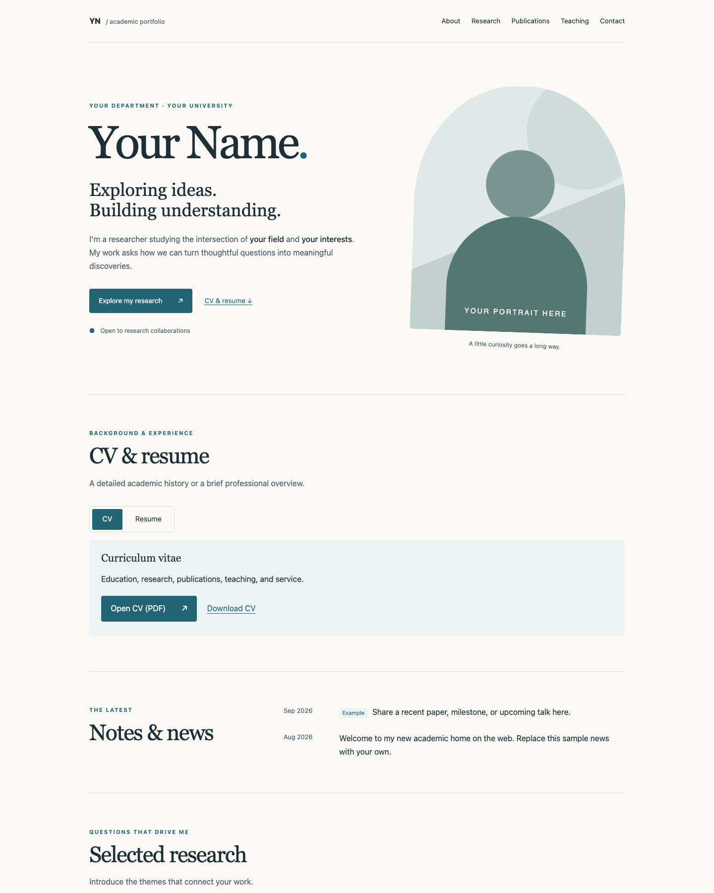

# Academic website template

A simple, responsive template for an academic or professional website, hosted on GitHub Pages. Created by [Jonathan Ma](https://github.com/JonathanMa03), inspired by Academic Pages. This is an independent implementation with no affiliation.

Plain HTML and CSS, with a little optional JavaScript. No framework, build step, package installation, tracking, or external font downloads.



## Get your website online

1. **Create your copy.** Select **Use this template → Create a new repository** on GitHub (or copy/fork this repository). Name it `YOUR-USERNAME.github.io` for a personal site, or use any other name for a project site.
2. **Make it yours.** Edit `index.html` with GitHub's file editor or locally. Replace the sample name, initials, biography, affiliation, research, publications, teaching, and contact details. Update the page title and description in `<head>`. Remove sections you don't need; all sample content is a placeholder.
3. **Add your files.** Upload a portrait to `public/images/` and update its path and `alt` text in `index.html`. Replace `public/documents/cv.pdf` and `public/documents/resume.pdf` with your own PDFs. Search for `EDIT SOCIAL LINKS` to update your profile URLs.
4. **Pick a style.** Choose colors and fonts below, then commit your changes.
5. **Publish your copy.** In your repository's **Settings → Pages**, select **Deploy from a branch**, choose **main** (or your website branch) and **/(root)**, then **Save**. Once deployment finishes, Pages shows your website URL. Later commits to that branch update the site automatically.

Your site will be at `https://YOUR-USERNAME.github.io/`, or `https://YOUR-USERNAME.github.io/REPOSITORY-NAME/` for a project repository. Each copy needs its own Pages setup. Use a public repository for the simplest setup; private-repository availability depends on your GitHub plan. See [GitHub's publishing guide](https://docs.github.com/en/pages/getting-started-with-github-pages/configuring-a-publishing-source-for-your-github-pages-site) for more help.

Keep `.nojekyll` in the root and asset paths relative (`public/images/photo.jpg`, without a leading `/`) so both URL formats work.

## Choose colors and fonts

Change just two attributes at the top of `index.html`. Every preset is already linked:

```html
<html lang="en" data-color="slate" data-font="modern">
```

| Setting | Options |
| --- | --- |
| `data-color` | `ocean` (default), `forest`, `plum`, `slate`, `terracotta`, `ochre`, `ink` |
| `data-font` | `editorial` (default), `modern`, `classic`, `humanist`, `literary`, `technical` |

Mix any palette and font preset for **42 combinations**. Fonts use what is installed on the visitor's device, with fallbacks.

| Try this pairing | Feel |
| --- | --- |
| `ocean` + `editorial` | Blue-green accents and serif headings; the default |
| `forest` + `humanist` | Botanical greens and friendly sans-serif type |
| `plum` + `classic` | Muted plum and traditional serif type |
| `slate` + `modern` | Cool blues and clean sans-serif type |
| `terracotta` + `literary` | Earthy rust and bookish serif type |
| `ochre` + `editorial` | Warm paper and golden-brown accents |
| `ink` + `technical` | Monochrome with monospace headings |

See the [styling guide](styling/README.md) for preset details and how to add your own.

## Where to edit

| Content | File or folder |
| --- | --- |
| Text, metadata, navigation, social links, theme selection | `index.html` |
| Portraits and other images | `public/images/` |
| CV and resume | `public/documents/cv.pdf`, `public/documents/resume.pdf` |
| Papers, slides, and other downloads | `public/documents/` |
| Favicon and logos | `public/logos/` |
| Layout and spacing | `styling/main.css` |
| Color and font presets | `styling/colors/`, `styling/fonts/` |

To upload PDFs on GitHub, open `public/documents/`, select **Add file → Upload files**, and commit your replacements. Keep the filenames above for the existing links to work. If you rename a PDF, update both its Open and Download links under `EDIT DOCUMENTS` in `index.html`. Both documents stay accessible without JavaScript.

Duplicate existing cards or publication entries to add content. For extra website pages, use HTML; Markdown files are documentation only. Keep social link text labels and the [icon attribution](public/logos/README.md).

Only publish material you have permission to share. All tracked files may be publicly accessible; `public/` is an organizational folder, not a privacy boundary.

## Preview locally

From the repository folder, run:

```sh
python3 -m http.server 8000 --bind 127.0.0.1
```

Open **http://127.0.0.1:8000**, edit files, and refresh to see changes. Stop the server with **Ctrl+C**. You can also open `index.html` directly for a quick look.

Before publishing, check desktop and mobile layouts, keyboard navigation, contact links, and document downloads. Optional source checks require Node.js 18+ and no installation:

```sh
npm run check
```

The README preview is a saved screenshot of the default theme. To refresh it, capture the local homepage at 1440 × 1800 and save it as `public/images/preview.png`.

## License and credit

Released under the [MIT License](LICENSE). Preserve its copyright notice when redistributing the template. The footer credits Jonathan Ma as the template creator; replace the separate site-owner name with yours. Your own content remains yours.

If you like this template or find it useful, please **star this repository on GitHub** to help others discover it.
