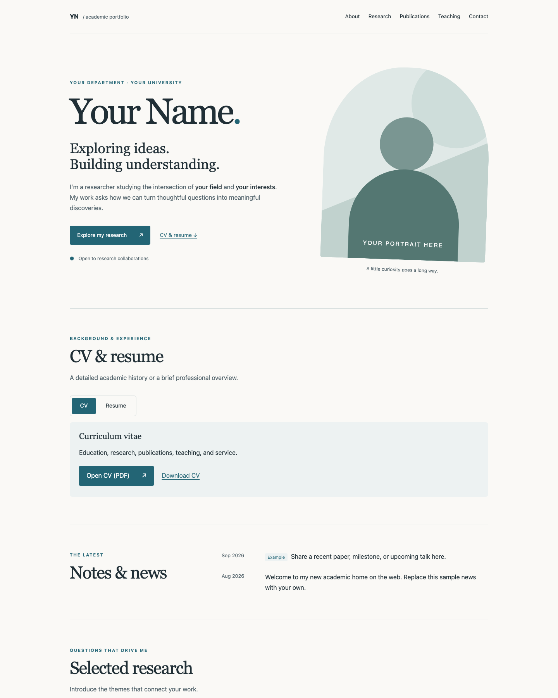

# Academic website template

A clean, responsive home for your research, publications, teaching, and ideas. Created by **[Jonathan Ma](https://github.com/JonathanMa03)**. Inspired by the purpose of academic portfolio sites such as Academic Pages; this is an independent implementation, with no affiliation.

Plain HTML and CSS. No framework, build step, paid service, analytics, or external font requests. Includes keyboard navigation, responsive layouts, reduced-motion support, and optional JavaScript for the copyright year.

## Preview



*Actual browser screenshot of the default ocean/editorial theme. Click the image on GitHub to view it at full size.*

To run the website locally, open a terminal in this repository and run:

```sh
python3 -m http.server 8000 --bind 127.0.0.1
```

Open **http://127.0.0.1:8000** in your browser. Keep the terminal running, edit your files, and refresh the browser to see changes. Stop the server with **Ctrl+C**. No package installation or build is needed. If port 8000 is already in use, change it to 8001 in both the command and URL.

### Refresh the README screenshot

The image is a saved screenshot, so it does not update automatically when the site changes. With the local server running:

1. Open the local URL in Chrome and open Developer Tools.
2. Toggle the device toolbar, select **Responsive**, and set the viewport to **1440 × 1800** at 100% zoom. Scroll to the top.
3. Open the Developer Tools command menu (**Cmd+Shift+P** on macOS, **Ctrl+Shift+P** on Windows/Linux) and choose **Capture screenshot**.
4. Save the image as `public/images/preview.png`, replacing the existing file, then commit it with the README and your other changes.

The relative image link above works directly on GitHub; visitors don't need a deployed website or your local server to see the screenshot. Publishing a personal copy with GitHub Pages is optional.

## Start your own website

1. The template owner should enable **Settings → General → Template repository** on GitHub once. Visitors can then select **Use this template → Create a new repository**. Alternatively, copy or fork it.
2. Name your repository `YOUR-USERNAME.github.io` for a personal site, or any name (for example, `academic-profile`) for a project site.
3. Edit `index.html`: replace **Your Name**, **YN**, affiliation, biography, sample dates, research, courses, contact address, and profile links. Update the page title and description in `<head>` too. Sample entries are fictional placeholders.
4. Replace `public/images/profile-placeholder.svg` with your portrait and update the image path, dimensions, and descriptive `alt` text. Replace the favicon in `public/logos/` if desired.
5. Upload your CV and resume as `public/documents/cv.pdf` and `public/documents/resume.pdf`, replacing the sample PDFs. The CV/Resume toggle and download links work automatically. Replace or remove sample publications and documents.
6. Choose your colors and fonts as described below, then publish.

## Enable GitHub Pages on your own copy

Create your own repository with **Use this template → Create a new repository**, select your GitHub account as the owner, and personalize the files. Cloning alone does not create a repository under your account. Each owner enables Pages separately; the template owner's Pages settings are not copied.

Commit and push your files first, then open **your new repository's Settings**:

| Location | Setting | Value |
| --- | --- | --- |
| General → Repository name | Name | `YOUR-USERNAME.github.io` for a personal root site, or a name such as `academic-profile` for a project site |
| General → Danger Zone | Repository visibility | Public for GitHub Free; private-repository Pages availability depends on your plan |
| Pages → Build and deployment | Source | **Deploy from a branch** |
| Pages → Build and deployment | Branch | **main**, or the branch containing your website files |
| Pages → Build and deployment | Folder | **/(root)** |
| Pages → Custom domain | Domain | Leave blank unless you own and configure a custom domain |
| Pages | Enforce HTTPS | Enable when available |

1. In **Settings → Pages**, choose the source, branch, and folder above, then click **Save**. The branch must already exist and contain `index.html`.
2. Wait for the Pages deployment to finish. Check the repository's **Actions** tab if you need to inspect progress or a failure. You do not need to create a custom workflow for this template.
3. Return to **Settings → Pages** and use the published URL shown there:
   - Repository named `YOUR-USERNAME.github.io`: `https://YOUR-USERNAME.github.io/`
   - Any other repository name: `https://YOUR-USERNAME.github.io/REPOSITORY-NAME/`
4. Open your site and check the portrait, profile links, CV, and resume. Subsequent pushes to the selected branch update the site automatically.

Your URL uses **your** GitHub username and repository name. The template creator's identity is only a separate attribution in the footer and license. Replace the sample name, metadata, contact details, and social profile links in `index.html` before publishing.

Keep `.nojekyll` in the repository root to serve these static files without Jekyll processing. Keep local asset links relative (`public/images/...`, not `/public/images/...`) so both URL formats work. No build command, package installation, custom workflow, or access token is required for branch-based publishing.

See GitHub's official [publishing source instructions](https://docs.github.com/en/pages/getting-started-with-github-pages/configuring-a-publishing-source-for-your-github-pages-site) and [site creation guide](https://docs.github.com/en/pages/getting-started-with-github-pages/creating-a-github-pages-site). For a custom domain, follow [GitHub's domain guide](https://docs.github.com/en/pages/configuring-a-custom-domain-for-your-github-pages-site); don't add a `CNAME` until you own and configure the domain.

## Keep the template repository unpublished

The template can be shared using its GitHub repository URL and the screenshot above; a deployed demo is optional. The template owner should leave **Settings → General → Template repository** enabled so others can create their own copies.

To disable an existing Pages site without removing the repository or template files:

1. Open the template repository's **Settings → Pages**.
2. Under **Build and deployment → Source**, select **Deploy from a branch**, even if it previously used GitHub Actions.
3. Set **Branch** to **None** and click **Save**.

This disables Pages publishing for this repository. People using the template can still enable Pages on their own repositories with the instructions above. There is no custom deployment workflow in this starter to remove. Local previews and the README screenshot continue to work.

Changing the README does not change GitHub's settings; the repository owner must complete the steps above. See GitHub's [instructions for disabling a Pages site by changing its source](https://docs.github.com/en/pages/getting-started-with-github-pages/deleting-a-github-pages-site#deleting-your-site-by-changing-the-source).

## Preview and requirements

Hosting needs only a GitHub account and a repository with Pages available. There are **no runtime dependencies** and nothing to install. `requirements.txt` documents that no Python packages are needed.

For local preview, install Python 3 and run this from the repository root:

```sh
python3 -m http.server 8000 --bind 127.0.0.1
```

Visit `http://127.0.0.1:8000`. Stop with Ctrl+C. You can also open `index.html` directly for a quick look.

Optional source checks require Node.js 18 or newer:

```sh
npm run check
```

No `npm install` is needed. Checks verify local HTML/CSS links, referenced files, and fragment targets. Before publishing, also review at mobile and desktop widths, tab through navigation, and open your document downloads.

## Easy edits: documents and social profiles

| What to change | Where to edit |
| --- | --- |
| CV PDF | Replace `public/documents/cv.pdf` |
| Resume PDF | Replace `public/documents/resume.pdf` |
| Social profiles | In `index.html`, search for `EDIT SOCIAL LINKS` and replace the `href` values |
| Document labels or filenames | In `index.html`, search for `EDIT DOCUMENTS` |
| Name, biography, and research | Edit the matching text in `index.html` |

**Upload PDFs using GitHub:** open `public/documents/` in your repository, choose **Add file → Upload files**, and drag in files named exactly `cv.pdf` and `resume.pdf` (lowercase). Commit the changes. With Pages enabled, the next deployment serves your updated PDFs. You can also replace the files locally and commit/push them. The supplied PDFs are clearly marked placeholders, not real credentials.

The **CV / Resume** buttons select which document's description and links appear. **Open** opens the PDF using the visitor's browser; **Download** offers a download. Visitors do not upload files through the website: the owner uploads them to the repository. No backend or account system is needed. Without JavaScript, both documents remain available.

The social icons are stored locally in `public/logos/`; keep their adjacent text labels for accessibility. They come from Font Awesome Free; see [icon attribution](public/logos/README.md). No social service is contacted until a visitor follows a link.

## Choose colors and fonts

Change the two attributes on the opening `<html>` tag in `index.html`:

```html
<html lang="en" data-color="forest" data-font="modern">
```

| Setting | Options | Default |
| --- | --- | --- |
| `data-color` | `ocean`, `forest`, `plum` | `ocean` |
| `data-font` | `editorial`, `modern`, `classic` | `editorial` |

Mix any palette and font preset. All fonts use local system stacks. Read [styling/README.md](styling/README.md) to add presets or adjust layout.

## Repository map

```text
index.html                  Your content, metadata, and theme selection
public/
  logos/                    Favicon and institution / project logos
  images/                   Portraits and research images
  documents/                Public CV, papers, slides, and handouts
  site.js                   CV/Resume toggle and year enhancement
styling/
  colors/                   Color presets
  fonts/                    Font presets
  main.css                  Responsive layout and components
scripts/check.mjs           Dependency-free source validation
AGENTS.md                   Instructions for Codex and other coding agents
requirements.txt            Python requirements (none)
LICENSE                     MIT license and creator attribution
```

## Add your content

- Duplicate an existing research card, publication `<li>`, news `<article>`, or teaching row and edit its content. Use unique IDs if you add new navigation sections.
- Put PDFs in `public/documents/`, then link with `<a href="public/documents/my-paper.pdf">Read paper (PDF)</a>`. Use short lowercase filenames with hyphens.
- Markdown files are repository documentation; this template does not render Markdown into website pages. Write new pages as HTML and copy the stylesheet links using the correct relative paths.
- Update generic Scholar, LinkedIn, ORCID, and GitHub links to your actual profiles, or remove them. Use only images and papers you have permission to publish.
- Everything committed to this repository may be publicly accessible, including documentation. `public/` is an organizational folder, not an access boundary. Never commit private documents, credentials, or sensitive information.

## License and credit

This template is released under the [MIT License](LICENSE). Keep the license and its copyright notice when distributing the template or substantial portions of it. The footer credits Jonathan Ma as the template creator; you may adapt the visible footer, while preserving the license notice. Your own content remains yours.

Template mode and Pages publishing are independent repository settings. Share the template repository and its README preview, and enable Pages only on repositories you want to publish.
